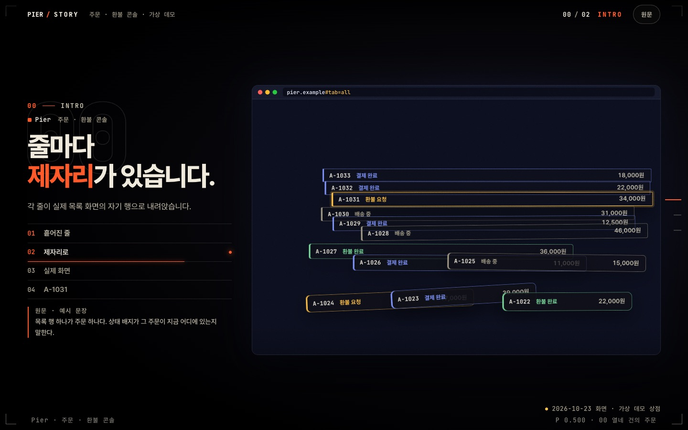
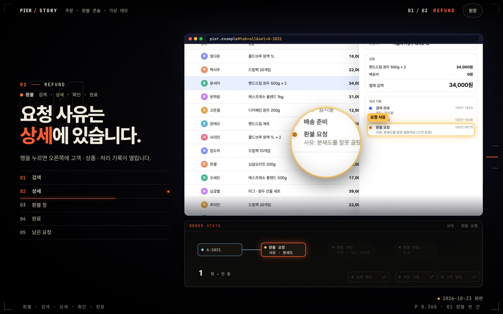

# story-html-v2

제품의 **실제 화면 캡처**를 주인공으로 한 단일 HTML 스크롤 스토리를 만드는 Claude Code 스킬입니다. [story-html](https://github.com/dearyour/story-html)(v1)의 무대·레이어·카피 문법은 그대로 두고, 제품 화면을 HTML 목업 대신 **실제 캡처 + 카메라**로 바꾸고, 설명 패널을 **동작 원리 모션 그래픽**으로 바꾼 판입니다.

- 스크롤하면 카메라가 캡처 위를 날아 **읽어야 할 곳**으로 가고, 링과 **돋보기**가 그 자리를 짚습니다.
- 데모 커서가 문장이 말하는 일을 직접 누르고, 타이핑·응답은 **녹화한 프레임**을 넘겨 보여 줍니다(다시 그리지 않음).
- 창 아래 어두운 패널은 그 화면이 **어떻게 동작하는지**를 노드·간선·패킷·카운터로 그립니다.
- 옆 칸에는 주장 한 줄과 그 단계의 근거 원문이 붙습니다. **스크롤만으로** 끝까지 읽힙니다.




> 예시 화면은 모두 가상 상점 **Pier**(스킬에 들어 있는 데모 앱)를 직접 띄워 찍은 것입니다. 이름·주문·금액은 전부 가상입니다.

## 설치

### 한 줄 설치 (권장 — 자동 업데이트까지 켜짐)

```bash
curl -fsSL https://raw.githubusercontent.com/dearyour/story-html-v2/main/install.sh | bash
```

플러그인 설치, **자동 업데이트 켜기**, `/story-html-v2` 짧은 별칭까지 한 번에 합니다([install.sh](install.sh)). v1(`story-html`)과 별도 마켓플레이스라 둘을 함께 써도 서로 건드리지 않습니다. 설치 후 Claude Code를 다시 시작하세요.

### Claude Code 플러그인 명령으로

```text
/plugin marketplace add dearyour/story-html-v2
/plugin install story-html-v2@story-html-v2
```

`/story-html-v2:story-html-v2`, 또는 “v2 디자인으로 이 도구 소개 페이지 만들어줘”, “실제 화면 캡처로 스크롤 스토리” 같은 요청에 쓰입니다. 짧게 `/story-html-v2`로 부르려면 `~/.claude/commands/story-html-v2.md`에 별칭을 둡니다(install.sh가 만들어 줍니다).

### 스킬 폴더만 복사해서

```bash
git clone https://github.com/dearyour/story-html-v2.git
cp -R story-html-v2/skills/story-html-v2 ~/.claude/skills/story-html-v2   # Claude Code
cp -R story-html-v2/skills/story-html-v2 ~/.codex/skills/story-html-v2    # Codex ($story-html-v2)
```

## 들어 있는 것

| 경로 | 내용 |
| --- | --- |
| `skills/story-html-v2/SKILL.md` | 작업 순서, 빠지면 미완성인 바닥, 꼭 지킬 것, 페이지마다 바닥을 넘는 의무 |
| `assets/starter/capture.mjs` | 실제 화면 촬영: 상태별 URL·단계 → WebP, **요소 박스 측정**(좌표를 눈대중으로 잡지 않음), 타이핑·응답 **녹화**, 공개용 **익명화**(DOM 글자 치환 · 금지 패턴이 남으면 저장 거부) |
| `assets/starter/src/app.js` | `AppCam`(캡처 위 카메라 · 링 · 돋보기 · 커서 · 녹화 재생), `AppChapter`, `Mech` + `Graph`(데이터 속성으로 쓰는 SVG 모션 그래픽), `box()` · `seq()` |
| `assets/starter/build.mjs` · `check.mjs` | 캡처를 내장한 단일 HTML 빌드(안 쓰는 캡처 자동 제외), 크기별·동작 줄이기 캡처 검사 |
| `assets/starter/demo-app/` · `shots/` | 촬영 대상 가상 앱과 그 캡처 — 예시 3장이 그대로 빌드됨 |
| `references/grammar.md` · `capture.md` | 디자인 시스템 전문(바닥 · 천장 · 카메라 문법 · API · 함정 · 검증), 촬영·익명화 |

## 출발점 직접 써 보기

```bash
cp -R skills/story-html-v2/assets/starter my-story && cd my-story
node build.mjs            # → dist/index.html (캡처 내장 단일 HTML)
open dist/index.html
node capture.mjs          # demo-app을 다시 찍기 (shots.config.mjs를 실제 제품으로 바꿔서 사용)
```

촬영·검사는 설치된 Google Chrome과 `playwright-core`를 씁니다. 처음 한 번:

```bash
mkdir -p ~/.cache/story-html-pw && cd ~/.cache/story-html-pw && npm init -y >/dev/null && npm i playwright-core
```

## 원칙 몇 가지

- **픽셀은 증거** — 제품 화면은 실제 캡처입니다. 실행할 수 없는 제품은 재구성 페이지를 같은 방식으로 찍고 `재구성 화면`이라고 밝힙니다.
- **과확대 금지** — 카메라는 화면 맥락이 보이는 폭(캡처 1060px)보다 좁히지 않고, 작은 글자는 돋보기로 읽힙니다.
- **스크롤만으로 끝까지** — 결정적인 동작도 데모 커서가 수행합니다. 상태 = 스크롤 진행률의 함수.
- **공개 페이지 익명화는 촬영 단계에서** — 치환 사전(`redact.local.mjs`)은 실명 목록이라 git에서 제외됩니다. 이미지·이니셜·슬러그는 글자 치환이 못 잡으니 캡처를 직접 확인합니다.
- **바닥이지 천장이 아니다** — 예시 장면을 그대로 쓰면 미완성입니다. 페이지마다 그 내용에만 있는 시그니처 장면과 바닥보다 한 단계 위의 연출을 새로 만듭니다.

## 라이선스

MIT
